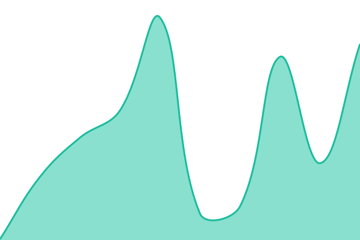
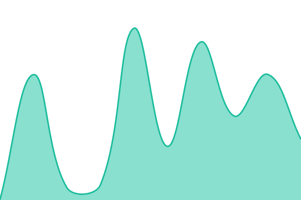

# [📈 Live Status](https://status.mcrsc.org): <!--live status--> **🟩 All systems operational**

This repository contains the open-source uptime monitor and status page for [md7marcu](https://status.mcrsc.org), powered by [Upptime](https://github.com/upptime/upptime).

With [Upptime](https://upptime.js.org), you can get your own unlimited and free uptime monitor and status page, powered entirely by a GitHub repository. We use [Issues](https://github.com/md7marcu/status/issues) as incident reports, [Actions](https://github.com/md7marcu/status/actions) as uptime monitors, and [Pages](https://status.mcrsc.org) for the status page.

<!--start: status pages-->
<!-- This summary is generated by Upptime (https://github.com/upptime/upptime) -->
<!-- Do not edit this manually, your changes will be overwritten -->
<!-- prettier-ignore -->
| URL | Status | History | Response Time | Uptime |
| --- | ------ | ------- | ------------- | ------ |
|  [WhereToWatch API](https://wtw.mcrsc.org/health) | 🟩 Up | [where-to-watch-api.yml](https://github.com/md7marcu/status/commits/HEAD/history/where-to-watch-api.yml) | 

 287ms
     
 | 

<a href="https://status.mcrsc.org/history/where-to-watch-api">87.11%</a>
    

|  [WhereToWatch search](https://wtw.mcrsc.org/health) | 🟩 Up | [wheretowatch-search.yml](https://github.com/md7marcu/status/commits/HEAD/history/wheretowatch-search.yml) | 

 221ms
     
 | 

<a href="https://status.mcrsc.org/history/wheretowatch-search">87.11%</a>
    

|  [WhereToWatch deploys](https://wtw.mcrsc.org/webhook) | 🟩 Up | [where-to-watch-deploys.yml](https://github.com/md7marcu/status/commits/HEAD/history/where-to-watch-deploys.yml) | 

 152ms
     
 | 

<a href="https://status.mcrsc.org/history/where-to-watch-deploys">87.11%</a>
    

|  [WhereToWatch API (staging)](https://wtw-staging.mcrsc.org/health) | 🟩 Up | [where-to-watch-api-staging.yml](https://github.com/md7marcu/status/commits/HEAD/history/where-to-watch-api-staging.yml) | 

 354ms
     
 | 

<a href="https://status.mcrsc.org/history/where-to-watch-api-staging">87.11%</a>
    

|  [WhereToWatch search (staging)](https://wtw-staging.mcrsc.org/health) | 🟩 Up | [wheretowatch-search-staging.yml](https://github.com/md7marcu/status/commits/HEAD/history/wheretowatch-search-staging.yml) | 

 172ms
     
 | 

<a href="https://status.mcrsc.org/history/wheretowatch-search-staging">87.11%</a>
    

|  [brak API](https://brak.mcrsc.org/health) | 🟩 Up | [brak-api.yml](https://github.com/md7marcu/status/commits/HEAD/history/brak-api.yml) | 

 243ms
     
 | 

<a href="https://status.mcrsc.org/history/brak-api">87.12%</a>
    

<!--end: status pages-->

[**Visit our status website →**](https://status.mcrsc.org)

## 📄 License

- Powered by: [Upptime](https://github.com/upptime/upptime)
- Code: [MIT](./LICENSE) © [Anand Chowdhary](https://anandchowdhary.com)
- Data in the `./history` directory: [Open Database License](https://opendatacommons.org/licenses/odbl/1-0/)
